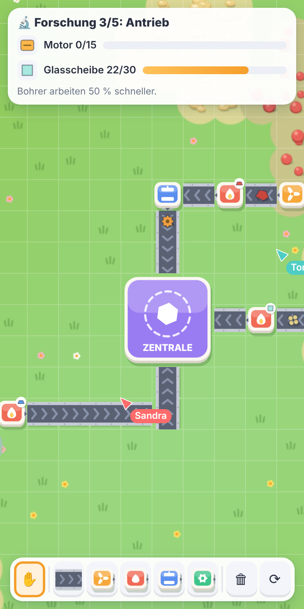
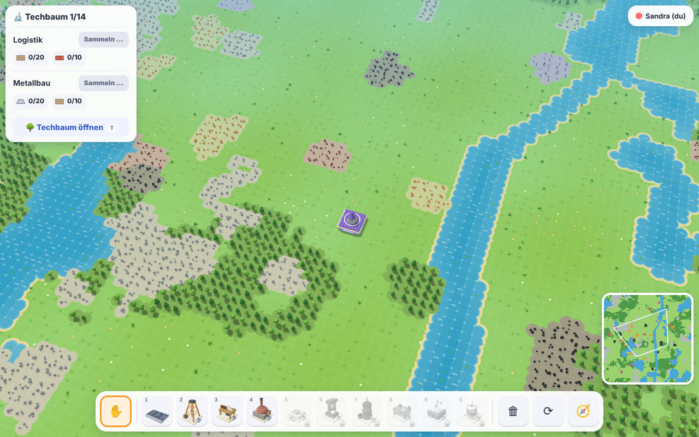
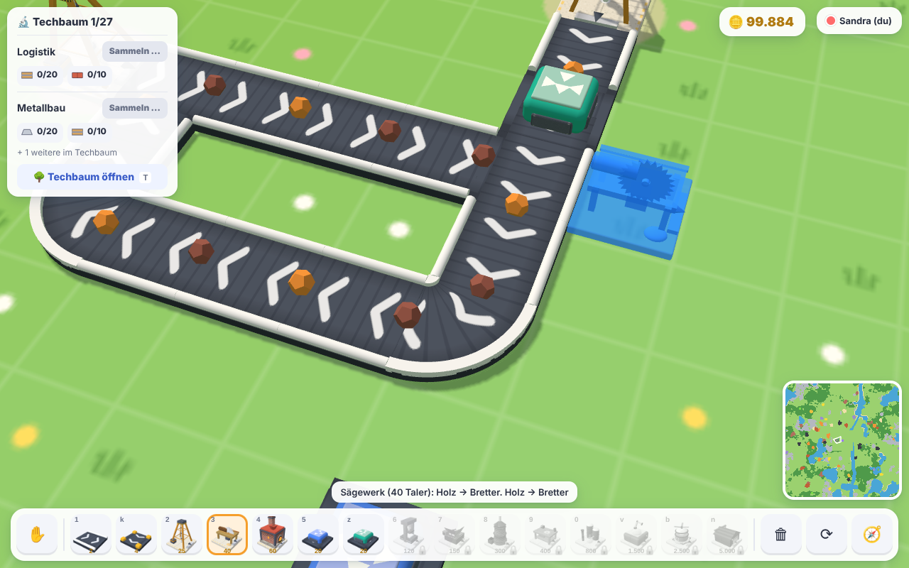
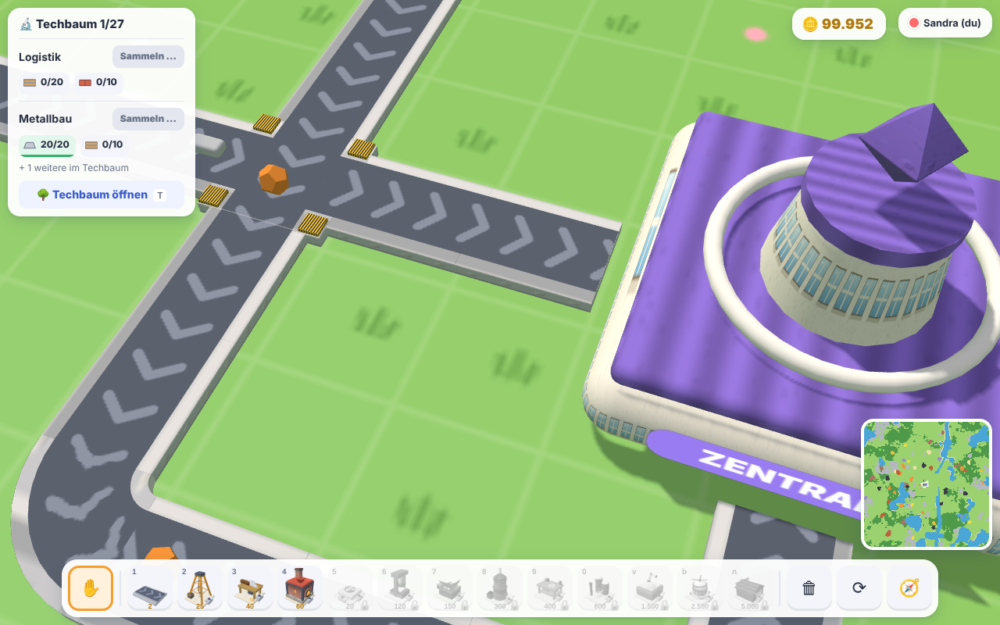
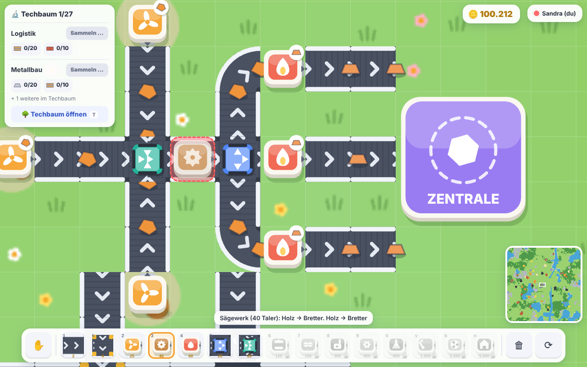

# Fabrik-Koop

Ein kooperatives Fabrikbau-Spiel im Browser. Mehrere Leute bauen gemeinsam in derselben Welt: Rohstoffe abbauen, über Förderbänder transportieren, in Maschinen verarbeiten und zur Zentrale liefern, um neue Technik zu erforschen. Läuft auf PC und Handy, ohne Installation.

<p align="center"> </p>
<p align="center"></p>
<p align="center"></p>
<p align="center"></p>
<p align="center"></p>
<p align="center"></p>

## Apps herunterladen

Fertige Apps gibt es bei jedem Build in GitHub Actions (Reiter „Actions“ → Lauf „Apps bauen“ → „Artifacts“) und bei Versionen unter „Releases“:

| Datei | Plattform | Was sie macht |
|---|---|---|
| `FabrikKoop-<version>-linux-amd64.deb` | Linux (Debian, Ubuntu, Mint …) | Spiel **mit eingebautem Server**. Installieren: `sudo apt install ./FabrikKoop-…-linux-amd64.deb`, dann „Fabrik-Koop“ im Startmenü |
| `FabrikKoop-<version>-windows-x64-portable.exe` | Windows 10/11 | Spiel **mit eingebautem Server**, ohne Installation per Doppelklick startbar |
| `FabrikKoop-<version>-android.apk` | Android 5.1+ | Spiel **ohne eigenen Server**: verbindet sich mit einem Rechner, auf dem Fabrik-Koop läuft |

So spielt ihr zusammen: Eine Person startet die Linux- oder Windows-App. Auf dem Startbildschirm steht „Mitspieler im selben Netzwerk verbinden sich mit: 192.168.…:3000“. Alle anderen tragen diese Adresse im Feld **Server** ein (am Handy ist das Pflicht) und wählen dieselbe Welt.

Hinweise:
- Windows zeigt beim ersten Start eventuell „Der Computer wurde durch Windows geschützt“, weil die Datei nicht signiert ist: „Weitere Informationen“ → „Trotzdem ausführen“. Die Windows-Firewall fragt, ob Netzwerkzugriff erlaubt ist: für Mitspieler im WLAN „Private Netzwerke“ erlauben.
- Am Handy muss die Installation aus „unbekannten Quellen“ erlaubt werden. Die APK ist mit einem Test-Schlüssel signiert; bei einem Update kann es nötig sein, die alte Version vorher zu deinstallieren.
- Spielstände der Desktop-App liegen unter Linux in `~/.config/Fabrik-Koop/saves`, unter Windows in `%APPDATA%\Fabrik-Koop\saves`.

Eine neue Version veröffentlichen: `version` in `package.json` erhöhen, Tag setzen (`git tag v0.2.0 && git push --tags`), dann baut GitHub alle drei Dateien und legt ein Release an.

## Im Browser starten (Server von Hand)

Voraussetzung: [Node.js](https://nodejs.org) ab Version 18.

```bash
npm install
npm start
```

Dann im Browser `http://localhost:3000` öffnen. Mitspieler im selben WLAN öffnen `http://<IP-deines-Rechners>:3000`. Alle, die denselben **Weltnamen** eingeben, spielen zusammen. Der Link enthält die Welt (`?welt=name`) und kann direkt verschickt werden.

Welten werden alle 15 Sekunden und beim Beenden in `saves/` gespeichert. Leere Welten pausieren.

Optionale Umgebungsvariablen: `PORT` (Standard 3000), `SAVE_DIR` (Standard `./saves`).

## So spielt man

1. **Bohrer** auf ein farbiges Vorkommen stellen. Er gibt Rohstoffe in Pfeilrichtung aus.
2. **Förderbänder** ziehen. Beim Ziehen zeigen die Bänder automatisch in Zugrichtung.
3. Rohstoffe durch **Maschinen** schicken und die Produkte zur **Zentrale** in der Mitte bringen.
4. Die Forschungsziele oben links erfüllen, um neue Gebäude und Verbesserungen freizuschalten.

### Geld

Gebaut wird mit **Talern** (Anzeige oben rechts). Jede Lieferung an die Zentrale bringt Taler. Verarbeitete Waren sind mehr wert: Jedes Produkt bringt 30 % mehr als seine Zutaten zusammen, plus etwas für die Arbeitszeit. Abreißen erstattet den vollen Preis. Neue Welten starten mit 300 Talern, alte Spielstände bekommen einmalig 1.000.

- Baukosten: Förderband 2 · Kreuzung 4 · Verteiler 20 · Zusammenführer 20 · Bohrer 25 · Sägewerk 40 · Schmelzofen 60 · Presse 120 · Steinbrecher 150 · Hochofen 300 · Werkbank 400 · Chemiewerk 800 · Fabrikator 1.500 · Zentrifuge 2.500 · Montagehalle 5.000
- Beispiele für Erlöse je Stück: Holz 1 · Eisenerz 2 · Eisenbarren 5 · Zahnrad 8 · Motor 24 · Steuerchip 65 · Roboterarm 120 · Computer 230 · Raumsonde 1.262

### Förderbänder

Bänder biegen sich von selbst: Wird ein Band nicht von hinten, sondern von der Seite beliefert, wird es zur Kurve. Die Gegenstände laufen sichtbar um die Kurve.

Eine **Kreuzung** setzt man von Hand: Im Bau-Menü die Kreuzung wählen (Taste **K**) und auf ein freies Feld oder direkt auf ein vorhandenes Band setzen. Beide Richtungen laufen dann geradeaus weiter, ohne sich zu vermischen. Eine Kreuzung kostet 4 Taler und darf auch auf Wasser stehen. Zieht man ein Band über ein anderes, wird es nur gedreht, eine Kreuzung entsteht nie von selbst. Kurven entstehen weiterhin automatisch.

### Rohstoffe

Elf Rohstoffe: Holz (Wald), Stein, Eisenerz, Kupfererz, Kohle, Quarzsand (an Ufern), Bauxit, Schwefel, Wolframerz, Golderz und Uranerz. Je seltener ein Rohstoff, desto weiter draußen liegt er: Holz, Stein, Eisen und Kupfer gibt es direkt bei der Zentrale, Gold, Wolfram und Uran nur am Rand.

### Die Karte

Neue Welten sind 160 × 160 Felder groß (vorher 80 × 80) und werden mit Rauschen natürlich erzeugt: große Wälder mit Lichtungen, felsiges Hochland mit Steinfeldern, Seen und ein Fluss, Erzfelder mit unregelmäßigen Rändern. Im **Wasser** gehen nur Förderbänder (als Brücke), Kreuzungen, Verteiler und Zusammenführer. Unten rechts zeigt eine **Übersichtskarte** die ganze Welt; antippen oder klicken springt dorthin, Taste M blendet sie aus. Bestehende kleinere Welten werden beim Laden automatisch auf 160 × 160 erweitert: Die alte Fläche mit allen Gebäuden bleibt in der Mitte, drumherum entsteht neues Land mit Seen, Fluss und allen Erzen.

### Produktionsketten

| Maschine | Rezepte |
|---|---|
| Sägewerk | Holz → Bretter |
| Schmelzofen | Eisenerz → Eisenbarren · Kupfererz → Kupferbarren · Stein → Ziegel · Quarzsand → Glasscheibe · Golderz → Goldbarren |
| Steinbrecher | Stein → Kies · Bauxit → Tonerde · Schwefel → Schwefelpulver |
| Presse | Eisenbarren → Zahnrad · Kupferbarren → Kupferdraht · Goldbarren → Golddraht · Aluminiumbarren → Alublech |
| Hochofen | Eisenbarren + Kohle → Stahlträger · Wolframerz + Kohle → Wolframbarren · Tonerde + Kohle → Aluminiumbarren |
| Werkbank | Zahnrad + Kupferdraht → Motor · Kupferdraht + Bretter → Platine · Glasscheibe + Kupferdraht → Glühbirne · Stahlträger + Ziegel → Stahlrahmen · Wolframbarren + Stahlträger → Bohrkopf · Uranpellet + Stahlrahmen → Energiezelle · Alublech + Stahlrahmen → Leichtrahmen |
| Chemiewerk | Kies + Ziegel → Betonblock · Betonblock + Stahlträger → Stahlbeton · Schwefelpulver + Kohle → Säurekanister · Säurekanister + Bretter → Kunstharz · Säurekanister + Kupferbarren → Batterie · Kunstharz + Kupferdraht → Isolierkabel |
| Fabrikator | Platine + 2× Golddraht → Steuerchip · Glasscheibe + Golddraht → Solarzelle · Motor + Steuerchip → Roboterarm · 2× Alublech + Motor → Turbine |
| Zentrifuge | Uranerz → Uranpellet |
| Montagehalle | Roboterarm + Bohrkopf + Batterie → Helferbot · Turbine + 2× Isolierkabel + Energiezelle → Generator · 2× Steuerchip + Kunstharz + Glühbirne → Computer · 2× Solarzelle + Leichtrahmen + Isolierkabel → Solarsegel · Computer + Generator + 2× Solarsegel → Raumsonde |

Der **Verteiler** (Taste 5) teilt ein Band auf: Gegenstände gehen abwechselnd nach vorne, rechts und links. Der **Zusammenführer** (Taste Z) macht das Gegenteil: Er nimmt Bänder von hinten, links und rechts an und schickt alles gerecht abwechselnd nach vorne auf ein Band. Beide sind von Anfang an freigeschaltet, kosten 20 Taler und lassen sich wie die Kreuzung direkt auf ein vorhandenes Band setzen (dann zählt die gewählte Richtung). Bänder laufen direkt in einen bunten, runden Kasten mit dunklen Öffnungen hinein und wieder heraus, weiße Pfeile oben zeigen die Richtungen (Verteiler blau, Zusammenführer türkis). Die Kreuzung erkennt man an vier gelben Eckpfosten. Förderbänder haben einen dunklen Gurt mit großen hellen Pfeilen und runde helle Seitenschienen; mündet ein Band seitlich ein, ist die Schiene dort offen. Auch alle Gebäude stehen auf einem Sockel, der das ganze Feld ausfüllt, sodass Bänder ohne Spalt anschließen.

Die **Montagehalle** braucht drei Zutaten gleichzeitig, also am besten von hinten, links und rechts anliefern.

<p align="center"></p>

### Techbaum

Alles, was an der Zentrale ankommt, landet im Lager. Im Techbaum (Taste T oder Knopf „Techbaum öffnen") gebt ihr es für neue Technik aus. Der Baum hat 27 Techniken in neun Stufen, vom Sägewerk bis zum Start der Raumsonde:

| Technik | Braucht | Kosten | Wirkung |
|---|---|---|---|
| Grundlagen | – | – | Bänder, Kreuzungen, Verteiler, Zusammenführer, Bohrer, Sägewerk und Schmelzofen. |
| Logistik | Grundlagen | 20× Bretter + 10× Ziegel | Bänder laufen 25 % schneller. |
| Metallbau | Grundlagen | 20× Eisenbarren + 10× Bretter | Schaltet die Presse frei. |
| Steinbruch | Grundlagen | 20× Ziegel + 10× Eisenbarren | Schaltet den Steinbrecher frei (Kies, Tonerde, Schwefelpulver). |
| Schnelle Bänder | Logistik | 30× Eisenbarren + 20× Ziegel | Bänder laufen 50 % schneller. |
| Hochofen | Metallbau | 20× Zahnrad + 30× Ziegel | Schaltet den Hochofen frei (braucht Kohle). |
| Werkbank | Metallbau | 20× Zahnrad + 20× Kupferdraht | Schaltet die Werkbank frei. |
| Scharfe Bohrer | Steinbruch, Metallbau | 30× Kies + 20× Zahnrad | Bohrer arbeiten 25 % schneller. |
| Turbobänder | Schnelle Bänder, Werkbank | 20× Motor + 15× Platine | Bänder laufen noch einmal 50 % schneller. |
| Elektrik | Werkbank | 25× Platine + 20× Glühbirne | Alle Maschinen arbeiten 20 % schneller. |
| Fabrikator | Hochofen, Werkbank | 20× Platine + 20× Stahlträger | Schaltet den Fabrikator frei. |
| Chemie | Steinbruch, Hochofen | 20× Stahlträger + 30× Kies + 20× Glasscheibe | Schaltet das Chemiewerk frei. |
| Solartechnik | Elektrik, Fabrikator | 20× Solarzelle + 40× Glasscheibe | Maschinen arbeiten 15 % schneller. |
| Steuerungstechnik | Fabrikator | 15× Steuerchip + 20× Motor | Maschinen arbeiten 25 % schneller. |
| Wolframbohrer | Scharfe Bohrer, Fabrikator | 10× Bohrkopf + 40× Kies | Bohrer arbeiten 40 % schneller. |
| Kunststoffe | Chemie | 25× Kunstharz + 10× Batterie | Bohrer arbeiten 20 % schneller. |
| Leichtbau | Fabrikator, Chemie | 30× Alublech + 15× Stahlrahmen | Bänder laufen 25 % schneller. |
| Magnetbänder | Turbobänder, Leichtbau | 10× Turbine + 40× Alublech | Bänder laufen noch einmal 50 % schneller. |
| Taktstraße | Steuerungstechnik | 20× Roboterarm + 20× Steuerchip | Alle Maschinen arbeiten 50 % schneller. |
| Montagehalle | Steuerungstechnik, Kunststoffe | 15× Roboterarm + 20× Isolierkabel + 20× Stahlbeton | Schaltet die Montagehalle frei (drei Zutaten). |
| Urantechnik | Wolframbohrer, Chemie | 20× Wolframbarren + 20× Säurekanister | Schaltet die Zentrifuge frei (für Uranerz). |
| Kleinreaktor | Urantechnik | 15× Energiezelle | Bohrer +50 %, Maschinen +25 %. |
| Helferbots | Montagehalle | 10× Helferbot | Helferbots warten die Bohrer: +30 %. |
| Rechenzentrum | Montagehalle | 10× Computer | Bänder +20 %, Maschinen +10 %. |
| Energienetz | Montagehalle, Kleinreaktor | 10× Generator | Alle Maschinen arbeiten 30 % schneller. |
| Raumfahrt | Helferbots, Rechenzentrum, Energienetz | 20× Solarsegel + 10× Computer | Bereitet den Start der Raumsonde vor. Maschinen +20 %. |
| Raumsonden-Start | Raumfahrt | 10× Raumsonde | Das große Ziel: 10 Raumsonden. Danach ist die Fabrik fertig! |

### Steuerung

| | PC | Handy |
|---|---|---|
| Bauen | Gebäude wählen (oder Taste 1–9, 0, K, Z, V, B, N), klicken/ziehen | Gebäude wählen, tippen/ziehen |
| Drehen | R | ⟳ |
| Abreißen | 🗑 wählen oder Taste X, klicken/ziehen | 🗑 wählen, tippen |
| Kamera | WASD, Leertaste/mittlere Maustaste + ziehen, Mausrad zoomt, Q/E oder 🧭 dreht | ✋ + ziehen, zwei Finger zoomen und drehen, 🧭 dreht |

## Selbst bauen

```bash
npm install
npm run desktop       # Desktop-App testen
npm run dist:linux    # dist/FabrikKoop-<version>-linux-amd64.deb
npm run dist:win      # dist/FabrikKoop-<version>-windows-x64-portable.exe (geht auch unter Linux)
npx cap sync android && cd android && ./gradlew assembleDebug   # braucht Android SDK und JDK 17
```

## Aufbau

- `src/game.js`: Spiellogik (Karte, Gebäude, Förderbänder, Rezepte, Forschung). Läuft nur auf dem Server.
- `src/server.js`: HTTP-Server für die Dateien in `public/` und WebSocket-Server, der jede Welt mit 10 Ticks pro Sekunde simuliert und den Zustand an alle Spieler schickt.
- `desktop/main.js`: Desktop-App (Electron). Startet den Server im Hintergrund und öffnet das Spielfenster.
- `android/`, `capacitor.config.json`: Android-App (Capacitor), die den Browser-Client aus `public/` enthält.
- `.github/workflows/build.yml`: baut alle drei Apps.
- `public/render3d.js`: 3D-Darstellung mit Three.js (liegt in `public/vendor/`, damit die Apps offline laufen). Ohne WebGL oder mit `?2d` in der Adresse gibt es die flache 2D-Ansicht.
- `public/`: Browser-Client (alles selbst gezeichnet, keine Bilddateien).
- `test/`: Tests für die Spiellogik (`npm test`).
