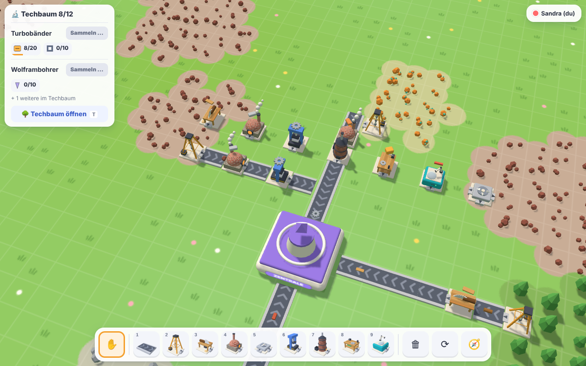
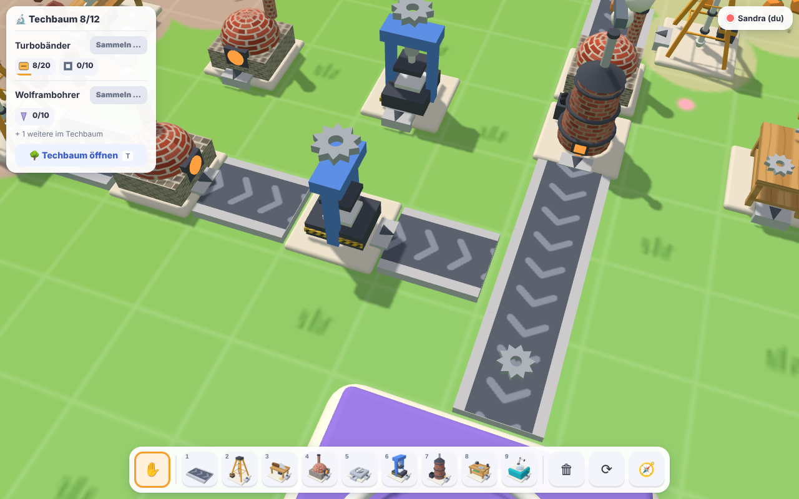
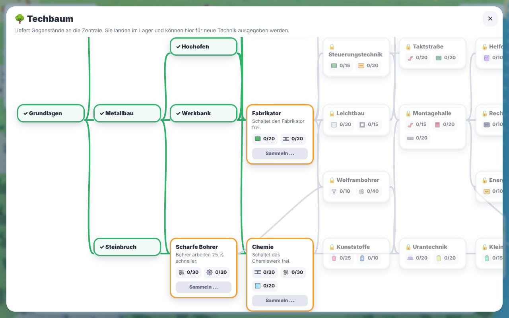

# Fabrik-Koop

Ein kooperatives Fabrikbau-Spiel im Browser. Mehrere Leute bauen gemeinsam in derselben Welt: Rohstoffe abbauen, über Förderbänder transportieren, in Maschinen verarbeiten und zur Zentrale liefern, um neue Technik zu erforschen. Läuft auf PC und Handy, ohne Installation.

<p align="center"> </p>
<p align="center"></p>
<p align="center"></p>

## Apps herunterladen

Fertige Apps gibt es bei jedem Build in GitHub Actions (Reiter „Actions“ → Lauf „Apps bauen“ → „Artifacts“) und bei Versionen unter „Releases“:

| Datei | Plattform | Was sie macht |
|---|---|---|
| `FabrikKoop-<version>-linux-amd64.deb` | Linux (Debian, Ubuntu, Mint …) | Spiel **mit eingebautem Server**. Installieren: `sudo apt install ./FabrikKoop-…-linux-amd64.deb`, dann „Fabrik-Koop“ im Startmenü |
| `FabrikKoop-<version>-windows-x64-portable.exe` | Windows 10/11 | Spiel **mit eingebautem Server**, ohne Installation per Doppelklick startbar |
| `FabrikKoop-<version>-android.apk` | Android 5.1+ | Spiel **ohne eigenen Server**: verbindet sich mit einem Rechner, auf dem Fabrik-Koop läuft |

So spielt ihr zusammen: Eine Person startet die Linux- oder Windows-App. Auf dem Startbildschirm steht „Mitspieler im selben Netzwerk verbinden sich mit: 192.168.…:3000“. Alle anderen tragen diese Adresse im Feld **Server** ein (am Handy ist das Pflicht) und wählen dieselbe Welt.

Hinweise:
- Windows zeigt beim ersten Start eventuell „Der Computer wurde durch Windows geschützt“, weil die Datei nicht signiert ist: „Weitere Informationen“ → „Trotzdem ausführen“. Die Windows-Firewall fragt, ob Netzwerkzugriff erlaubt ist: für Mitspieler im WLAN „Private Netzwerke“ erlauben.
- Am Handy muss die Installation aus „unbekannten Quellen“ erlaubt werden. Die APK ist mit einem Test-Schlüssel signiert; bei einem Update kann es nötig sein, die alte Version vorher zu deinstallieren.
- Spielstände der Desktop-App liegen unter Linux in `~/.config/Fabrik-Koop/saves`, unter Windows in `%APPDATA%\Fabrik-Koop\saves`.

Eine neue Version veröffentlichen: `version` in `package.json` erhöhen, Tag setzen (`git tag v0.2.0 && git push --tags`), dann baut GitHub alle drei Dateien und legt ein Release an.

## Im Browser starten (Server von Hand)

Voraussetzung: [Node.js](https://nodejs.org) ab Version 18.

```bash
npm install
npm start
```

Dann im Browser `http://localhost:3000` öffnen. Mitspieler im selben WLAN öffnen `http://<IP-deines-Rechners>:3000`. Alle, die denselben **Weltnamen** eingeben, spielen zusammen. Der Link enthält die Welt (`?welt=name`) und kann direkt verschickt werden.

Welten werden alle 15 Sekunden und beim Beenden in `saves/` gespeichert. Leere Welten pausieren.

Optionale Umgebungsvariablen: `PORT` (Standard 3000), `SAVE_DIR` (Standard `./saves`).

## So spielt man

1. **Bohrer** auf ein farbiges Vorkommen stellen. Er gibt Rohstoffe in Pfeilrichtung aus.
2. **Förderbänder** ziehen. Beim Ziehen zeigen die Bänder automatisch in Zugrichtung.
3. Rohstoffe durch **Maschinen** schicken und die Produkte zur **Zentrale** in der Mitte bringen.
4. Die Forschungsziele oben links erfüllen, um neue Gebäude und Verbesserungen freizuschalten.

### Rohstoffe

Holz (Wald), Stein, Eisenerz, Kupfererz, Kohle und Wolframerz. Kohle und Wolfram liegen weiter weg von der Zentrale, Wolfram ist selten.

### Produktionsketten

| Maschine | Rezepte |
|---|---|
| Sägewerk | Holz → Bretter |
| Schmelzofen | Eisenerz → Eisenbarren · Kupfererz → Kupferbarren · Stein → Ziegel |
| Presse | Eisenbarren → Zahnrad · Kupferbarren → Kupferdraht |
| Hochofen | Eisenbarren + Kohle → Stahlträger · Wolframerz + Kohle → Wolframbarren |
| Werkbank | Zahnrad + Kupferdraht → Motor · Kupferdraht + Bretter → Platine · Stahlträger + Ziegel → Stahlrahmen · Wolframbarren + Stahlträger → Bohrkopf |
| Fabrikator | Motor + Platine → Roboterarm · Roboterarm + Bohrkopf → Helferbot |

Der **Verteiler** schickt Gegenstände abwechselnd nach vorne, rechts und links.

### Techbaum

Alles, was an der Zentrale ankommt, landet im Lager. Im Techbaum (Taste T oder Knopf „Techbaum öffnen") gebt ihr es für neue Technik aus. Jede Technik braucht ihre Vorgänger:

- Grundlagen → **Logistik** (Verteiler) → **Schnelle Bänder** → **Turbobänder**
- Grundlagen → **Metallbau** (Presse) → **Hochofen** und **Werkbank**
- Werkbank → **Scharfe Bohrer** → **Wolframbohrer** (braucht auch Hochofen)
- Hochofen + Werkbank → **Fabrikator** → **Taktstraße** (alle Maschinen schneller)
- Fabrikator + Wolframbohrer → **Helferbot-Programm**: 10 Helferbots, dann ist die Fabrik fertig

Alte Spielstände werden beim Laden umgewandelt: Die Vorkommen werden zu Eisen, Kupfer und Stein, und der Techbaum fängt von vorne an.

### Steuerung

| | PC | Handy |
|---|---|---|
| Bauen | Gebäude wählen (oder Taste 1–9), klicken/ziehen | Gebäude wählen, tippen/ziehen |
| Drehen | R | ⟳ |
| Abreißen | Rechtsklick oder X | 🗑 wählen, tippen |
| Kamera | WASD, Leertaste/mittlere Maustaste + ziehen, Mausrad zoomt, Q/E oder 🧭 dreht | ✋ + ziehen, zwei Finger zoomen und drehen, 🧭 dreht |

## Selbst bauen

```bash
npm install
npm run desktop       # Desktop-App testen
npm run dist:linux    # dist/FabrikKoop-<version>-linux-amd64.deb
npm run dist:win      # dist/FabrikKoop-<version>-windows-x64-portable.exe (geht auch unter Linux)
npx cap sync android && cd android && ./gradlew assembleDebug   # braucht Android SDK und JDK 17
```

## Aufbau

- `src/game.js`: Spiellogik (Karte, Gebäude, Förderbänder, Rezepte, Forschung). Läuft nur auf dem Server.
- `src/server.js`: HTTP-Server für die Dateien in `public/` und WebSocket-Server, der jede Welt mit 10 Ticks pro Sekunde simuliert und den Zustand an alle Spieler schickt.
- `desktop/main.js`: Desktop-App (Electron). Startet den Server im Hintergrund und öffnet das Spielfenster.
- `android/`, `capacitor.config.json`: Android-App (Capacitor), die den Browser-Client aus `public/` enthält.
- `.github/workflows/build.yml`: baut alle drei Apps.
- `public/render3d.js`: 3D-Darstellung mit Three.js (liegt in `public/vendor/`, damit die Apps offline laufen). Ohne WebGL oder mit `?2d` in der Adresse gibt es die flache 2D-Ansicht.
- `public/`: Browser-Client (alles selbst gezeichnet, keine Bilddateien).
- `test/`: Tests für die Spiellogik (`npm test`).
